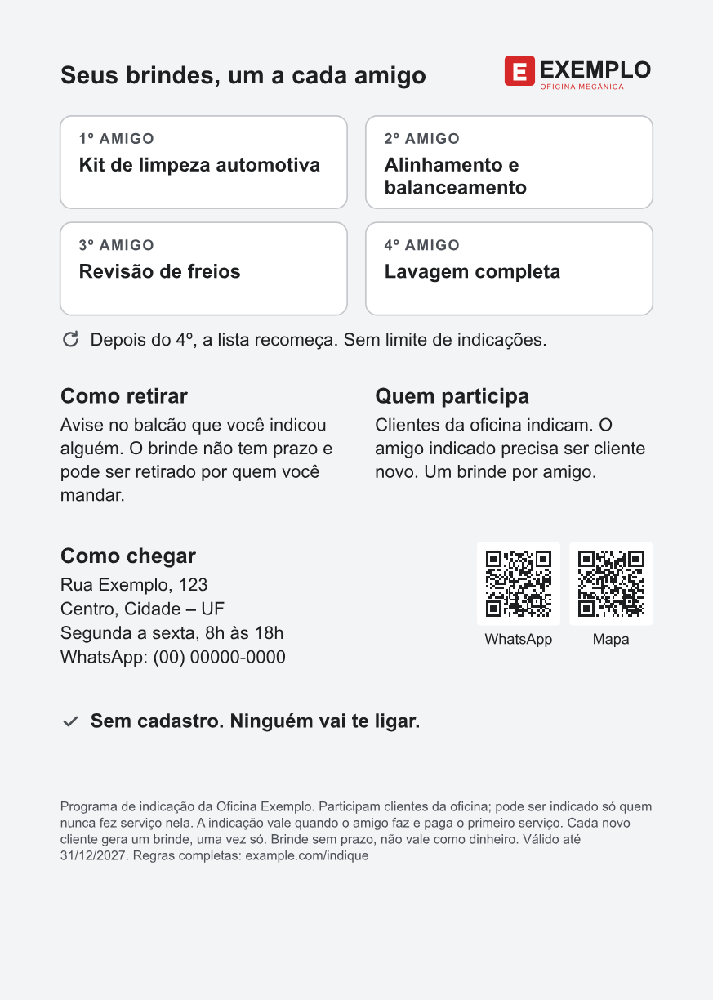

# flyer-cmyk-skill

**Skill para o Claude criar flyers e impressos promocionais prontos para a gráfica:
CMYK de verdade, texto em curvas e PDF/X-1a validado.**

*A Claude skill that produces print-ready promotional flyers (true CMYK, outlined text,
validated PDF/X-1a). Docs in Brazilian Portuguese.*

| Frente | Verso |
|---|---|
|  |  |

<sub>Exemplo incluído na skill, de uma empresa fictícia. A arte real sai em CMYK; as
imagens acima são a prévia de tela.</sub>

## O que ela faz

Você pede "faz um flyer da minha promoção para mandar para a gráfica" e o Claude:

1. **Pergunta o que falta**: empresa, oferta e regras, contatos, links dos QR codes,
   logo em SVG, cores, fontes e fotos. Ele procura antes nos arquivos do seu projeto
   para não perguntar o que já está lá. Nada é inventado.
2. **Monta uma equipe de agentes**:
   - um **estrategista de marketing**: conteúdo, hierarquia e chamada para ação;
   - um **especialista em psicologia de marketing**: leitura em 3 segundos, confiança,
     legibilidade para o público 40+, uso da cor e ética (nada de cara de golpe);
   - um **designer gráfico**: concilia os dois numa especificação com medidas exatas
     em mm.
3. **Implementa a arte** em SVG vetorial, com texto convertido em curvas e cada cor
   definida em CMYK (Coated FOGRA39).
4. **Mostra a arte ao designer**, que critica e corrige.
5. **Gera o PDF para a gráfica**: PDF/X-1a:2003 em **CMYK nativo** (o preto é K100
   puro, não preto de 4 cores), com sangria, marcas de corte, TrimBox/BleedBox e foto
   convertida para CMYK.
6. **Valida o PDF automaticamente**: confere que não há RGB, fontes ou transparência,
   que a tinta total está em até 300% e que os QR codes são lidos e levam aos endereços
   certos.

## Instalação

**Com o [skills.sh](https://skills.sh)** (Claude Code, Cursor, Codex e outros):

```bash
npx skills add Lucas-Varga/flyer-cmyk-skill --skill impresso-grafica -a claude-code -g
```

Sem `-g`, a skill fica só no projeto atual (`.claude/skills/`).

**Como plugin do Claude Code:**

```
/plugin marketplace add Lucas-Varga/flyer-cmyk-skill
/plugin install flyer-cmyk@flyer-cmyk-skill
```

**Manual:** copie a pasta `skills/impresso-grafica` para `~/.claude/skills/`.

Depois é só pedir, por exemplo: *"crie um flyer A5 frente e verso da nossa campanha de
indicação para mandar para a gráfica"*.

## Requisitos

> ⚠️ **Feita e testada para macOS.** Em Linux e Windows, funciona com as trocas da seção
> seguinte.

- macOS com **Python 3.10+** e **Google Chrome** instalado em `/Applications`;
- pacotes Python de `skills/impresso-grafica/scripts/requirements.txt`. O Claude cria
  um ambiente virtual e instala sozinho;
- para o resultado sair com a sua marca: **logo em SVG vetorial** e os **arquivos das
  fontes** (TTF, OTF ou WOFF2).

O que usa recursos do macOS:

| Etapa | No macOS | Arquivo |
|---|---|---|
| Converter foto para CMYK | `sips` com o perfil *Generic CMYK* do sistema | `scripts/pdf_cmyk.py` → `_foto_cmyk` |
| Prévia do SVG | Chrome headless em `/Applications/Google Chrome.app` | `scripts/previa_svg.sh` (zsh) |
| Fonte do exemplo | Arial em `/System/Library/Fonts/Supplemental/` | `assets/exemplo/montar.py` |

## Linux e Windows: o que trocar

**Windows:** o caminho mais simples é usar o **WSL** (Ubuntu) e seguir as instruções de
Linux.

**Converter a foto para CMYK** (troque o corpo de `_foto_cmyk` em `pdf_cmyk.py`):

- **Pillow (ImageCms)**, sem programa externo. Precisa de um perfil ICC CMYK, de
  preferência FOGRA39 ou ISO Coated v2, da [ECI](https://www.eci.org) ou da
  [color.org](https://www.color.org):
  ```python
  from PIL import ImageCms
  srgb = ImageCms.createProfile('sRGB')
  cmyk = ImageCms.getOpenProfile('/caminho/ISOcoated_v2_eci.icc')
  res = ImageCms.profileToProfile(im, srgb, cmyk, outputMode='CMYK',
                                  renderingIntent=ImageCms.Intent.RELATIVE_COLORIMETRIC)
  ```
- **ImageMagick:**
  `magick foto.jpg -profile sRGB.icc -profile ISOcoated_v2_eci.icc foto-cmyk.tif`

**Prévia do SVG** (troque `scripts/previa_svg.sh`):

- Linux: `google-chrome --headless=new --screenshot=...` ou `chromium --headless ...`
  com os mesmos parâmetros; ou `rsvg-convert -d 300 -p 300 arte.svg -o arte.png`
  (pacote `librsvg2-bin`).
- Windows nativo: `"C:\Program Files\Google\Chrome\Application\chrome.exe" --headless=new ...`
  em PowerShell; ou `inkscape arte.svg --export-type=png --export-dpi=300`.

**Fontes do exemplo** (troque os caminhos em `assets/exemplo/montar.py`):

- Linux: `/usr/share/fonts/truetype/liberation/LiberationSans-Regular.ttf` e
  `LiberationSans-Bold.ttf` (pacote `fonts-liberation`);
- Windows: `C:\Windows\Fonts\arial.ttf` e `arialbd.ttf`.

O resto (texto em curvas, QR codes, PDF CMYK, validação) é Python puro e roda igual nos
três sistemas.

## Estrutura

```
skills/impresso-grafica/
├── SKILL.md                     # o fluxo que o Claude segue
├── scripts/
│   ├── impressao.py             # arte: CMYK, texto em curvas, QR, logo, foto, ícones
│   ├── pdf_cmyk.py              # PDF/X-1a CMYK nativo com marcas de corte
│   ├── validar_pdf.py           # confere cores, tinta, caixas e QR codes
│   ├── previa_svg.sh            # SVG → PNG (Chrome headless)
│   └── requirements.txt
├── assets/exemplo/              # flyer de exemplo executável (empresa fictícia)
│   ├── montar.py
│   └── marca/logo-claro.svg, logo-escuro.svg
└── references/
    ├── prompts-agentes.md       # prompts dos agentes de marketing, psicologia e design
    └── producao-grafica.md      # regras de cor, PDF/X, medidas e armadilhas
```

Para rodar o exemplo à mão (macOS):

```bash
cd skills/impresso-grafica
python3 -m venv .venv && .venv/bin/pip install -r scripts/requirements.txt
cp scripts/impressao.py scripts/pdf_cmyk.py assets/exemplo/
cd assets/exemplo && ../../.venv/bin/python montar.py --pdf
../../.venv/bin/python ../../scripts/validar_pdf.py saida/flyer-grafica.pdf --saida saida/prev
```

## Limites e cuidados

- O PDF segue o padrão **PDF/X-1a:2003** com intenção de saída FOGRA39, identificada
  pelo nome registrado, sem perfil embutido. É o padrão mais aceito pelas gráficas
  brasileiras. Mesmo assim, **peça sempre prova de cor e prova física** antes da
  tiragem.
- A conversão da foto usa um perfil CMYK genérico. Para fotos em que a cor é crítica,
  deixe a gráfica converter, ou use um perfil FOGRA39 (veja acima).
- A prévia de tela de um preto rico (C60 K100) aparece azulada. Impresso, ele fica preto.

## Licença

[MIT](LICENSE)
