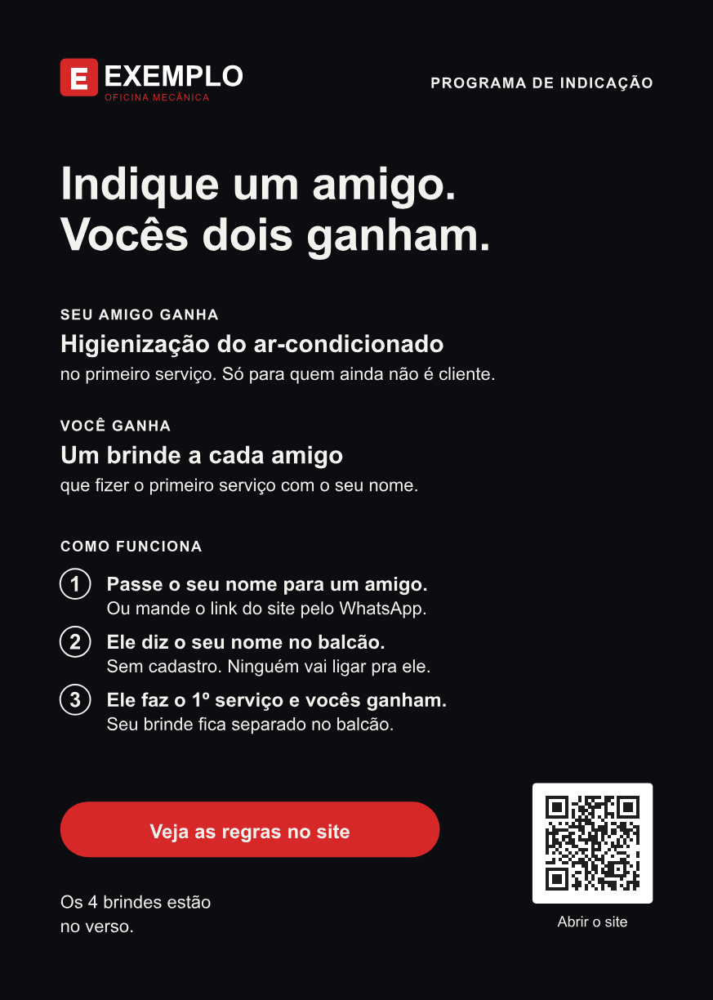

# flyer-cmyk-skill

**[English](#english) · [Português](#português)**

| Front / Frente | Back / Verso |
|---|---|
|  |  |

<sub>Test flyer made with the skill for a fictional gym, with an AI-generated image. The
real PDF is CMYK; the images above are screen previews. · Flyer de teste feito com a
skill para uma academia fictícia, com imagem por IA. O PDF real sai em CMYK; as imagens
acima são a prévia de tela.</sub>

---

## English

**A Claude skill that guides you from idea to a print-ready flyer for any campaign: true
CMYK and Pantone, gradients, special finishes, optional AI imagery and a validated
PDF/X-1a.**

> The skill talks to you in **Brazilian Portuguese** and its print defaults (formats, paper
> names, legal notes) follow Brazilian print shops. The technical output (CMYK PDF/X-1a,
> finish masks) is standard worldwide.

### What it does

You ask something like *"make a flyer for my store's grand opening to send to the print
shop"*, and Claude:

1. **Guides the decisions** with multiple-choice questions, always with a recommended
   option and what each choice implies:
   - **format**: A6, A5, A4, A3, DL, 10×14, 10×15, 15×21, 20×28, square 15 or 21,
     business card, or **any custom size in mm**;
   - **sides**: front only or front and back;
   - **paper**: coated or uncoated (color profile and ink limit change with it);
   - **special finishes**: spot UV varnish, hot foil stamping, blind embossing, white
     ink, custom die-cut;
   - **visual style** and the brand's **Pantone** color;
   - **AI images**: OpenAI, Google Gemini or Stability AI, with the key in a `.env`.
2. **Collects your material step by step**:
   - base images: each one is diagnosed and you choose to use it as is, enhance it,
     edit it or recreate it with AI;
   - approved phrases;
   - information sources such as websites and PDFs, which it reads and extracts facts
     from.

   Everything is saved to a `briefing.md`, so the work can resume where it stopped. It
   never makes things up.
3. **Puts together a team of agents**:
   - a **marketing strategist**: content, hierarchy, call to action;
   - a **marketing psychology specialist**: 3-second read, objections, legibility,
     color, ethics;
   - a **graphic designer**: concept, palette, gradients, effects and finishes, every
     element in mm, and the image brief.
4. **Generates the AI images** if you want, already sized for print. With OpenAI it
   picks the best model on your account automatically.
5. **Builds the artwork**:
   - vector SVG with outlined text;
   - CMYK or Pantone (Separation) colors;
   - gradients, text outline and shadow, free shapes;
   - duotone, veiled or faded photos.
6. **Shows the artwork to the designer**, who reviews it and fixes issues.
7. **Produces the print files**:
   - artwork in **native CMYK PDF/X-1a:2003** with crop marks, bleed and
     TrimBox/BleedBox;
   - **finish masks** in a separate PDF (K100), the format print shops ask for.
8. **Validates automatically**: no RGB, no fonts, no transparency, ink within the
   paper's limit, black-only masks, and QR codes that actually scan.

### Installation

**With [skills.sh](https://skills.sh)** (Claude Code, Cursor, Codex and others):

```bash
npx skills add Lucas-Varga/flyer-cmyk-skill --skill impresso-grafica -a claude-code -g
```

Without `-g`, the skill is installed only in the current project (`.claude/skills/`).

**As a Claude Code plugin** (updates through the marketplace and can be disabled without
deleting it; the skill shows up as `flyer-cmyk:impresso-grafica`):

```
/plugin marketplace add Lucas-Varga/flyer-cmyk-skill
/plugin install flyer-cmyk@flyer-cmyk-skill
```

In a terminal: `claude plugin marketplace add Lucas-Varga/flyer-cmyk-skill` and then
`claude plugin install flyer-cmyk@flyer-cmyk-skill`. Only the plugin folder (~220 KB) is
downloaded.

**In the Claude app, so it shows in your account's Plugins tab** (optional; it also
syncs to your other devices): download
**[flyer-cmyk.plugin](https://github.com/Lucas-Varga/flyer-cmyk-skill/releases/latest/download/flyer-cmyk.plugin)**
from the [latest release](https://github.com/Lucas-Varga/flyer-cmyk-skill/releases/latest),
drop it into a conversation in the Claude app and accept the plugin in the preview card
(or use the upload option in the app's plugin settings, if your plan offers it).

> Plugins installed with `/plugin` live only in Claude Code on that computer. The app's
> Plugins tab lists the plugins on your **claude.ai account**. These are two separate
> places.

**Manual:** copy `plugins/flyer-cmyk/skills/impresso-grafica` to `~/.claude/skills/`.

Then just ask: *"create an A5 double-sided flyer for our gym's grand opening to send to
the print shop"*.

### AI images (optional)

If you choose to generate images, the API key goes in a **`.env`** file in the working
folder, never in the chat. Use the template
`plugins/flyer-cmyk/skills/impresso-grafica/assets/env.exemplo`:

```
OPENAI_API_KEY=your-key          # OpenAI (best model on the account, e.g. gpt-image-2.x)
GEMINI_API_KEY=your-key          # Google Gemini (gemini-2.5-flash-image)
STABILITY_API_KEY=your-key       # Stability AI (Stable Image Core)
```

Fill in only the provider you will use, and keep `.env` out of git. If the variable
already exists in your environment, the `.env` is not needed. Every image has a cost at
the provider. **OpenAI is tested** (generate, edit, enhance); Google and Stability follow
their public docs and may need adjusting if the APIs change.

The AI is told **not** to render text or logos, so all text stays in the vector artwork
with no typos. Images are converted to CMYK with an ink limit, and the footer gets an
"illustrative images" notice.

### Requirements

> ⚠️ **Built and tested on macOS.** Linux and Windows work with the swaps listed below.

- macOS with **Python 3.10+** and **Google Chrome** in `/Applications`;
- the packages in `plugins/flyer-cmyk/skills/impresso-grafica/scripts/requirements.txt`
  (Claude creates a virtual environment and installs them);
- for on-brand results: a **vector SVG logo** and the **font files** (TTF, OTF, WOFF2 or
  TTC). Without brand fonts, the skill suggests system fonts.

What relies on macOS:

| Step | On macOS | File |
|---|---|---|
| Photo to CMYK and preview | `sips` + ColorSync *Generic CMYK* and *sRGB* profiles | `scripts/impressao.py` → `_sips`, `PERFIL_*` |
| SVG preview | headless Chrome in `/Applications/Google Chrome.app` | `scripts/previa_svg.sh` (zsh) |
| Example fonts | Arial and Futura/Avenir in `/System/Library/Fonts` | `assets/exemplo/montar.py`, `exemplos/` |

### Linux and Windows: what to swap

**Windows:** the easiest path is **WSL** (Ubuntu), then follow the Linux notes.

**Photo color conversion** (replace `_sips` and `PERFIL_CMYK` in `impressao.py`):

- **Pillow (ImageCms)**, no external program. Needs a CMYK ICC profile, preferably
  FOGRA39 or ISO Coated v2, from [ECI](https://www.eci.org) or
  [color.org](https://www.color.org):
  ```python
  from PIL import ImageCms
  srgb = ImageCms.createProfile('sRGB')
  cmyk = ImageCms.getOpenProfile('/path/ISOcoated_v2_eci.icc')
  res = ImageCms.profileToProfile(im, srgb, cmyk, outputMode='CMYK',
                                  renderingIntent=ImageCms.Intent.RELATIVE_COLORIMETRIC)
  ```
- **ImageMagick:**
  `magick photo.jpg -profile sRGB.icc -profile ISOcoated_v2_eci.icc photo-cmyk.tif`

With `PERFIL_CMYK` pointing to that profile, the color preview (`Cmyk.rgb_tela`) is
accurate again. Without a profile, it falls back to a simple approximation.

**SVG preview** (replace `scripts/previa_svg.sh`):

- Linux: `google-chrome --headless=new --screenshot=...` or `chromium --headless ...`, or
  `rsvg-convert -d 300 -p 300 art.svg -o art.png` (package `librsvg2-bin`).
- Native Windows: `"C:\Program Files\Google\Chrome\Application\chrome.exe" --headless=new ...`
  in PowerShell, or `inkscape art.svg --export-type=png --export-dpi=300`.

**Fonts:**

- Linux: Liberation Sans (`fonts-liberation`) or any Google Fonts family (Montserrat,
  Inter, Bebas Neue, Oswald);
- Windows: `C:\Windows\Fonts\arial.ttf`, `arialbd.ttf`, `impact.ttf`, `bahnschrift.ttf`.

Everything else is pure Python and runs the same on all three systems: outlined text,
gradients, Pantone, QR codes, CMYK PDF, masks, validation and image generation.

### Repository layout

```
.claude-plugin/marketplace.json  # Claude Code marketplace (points to plugins/flyer-cmyk)
skills.sh.json                   # tells `npx skills add` where the skill is
scripts/empacotar-plugin.sh      # builds flyer-cmyk.plugin for the Claude app
plugins/flyer-cmyk/              # the plugin: only this is downloaded on install
├── .claude-plugin/              # plugin.json + icon.png
├── README.md
└── skills/impresso-grafica/
    ├── SKILL.md                     # the guided flow Claude follows
    ├── scripts/
    │   ├── impressao.py             # artwork: CMYK/Pantone, gradients, outlined text, effects, finishes
    │   ├── pdf_cmyk.py              # CMYK PDF/X-1a + finish-mask PDF
    │   ├── validar_pdf.py           # checks color, ink, transparency, boxes and QR
    │   ├── gerar_imagem.py          # AI images (OpenAI / Google / Stability) via .env
    │   ├── previa_svg.sh            # SVG → PNG (headless Chrome)
    │   └── requirements.txt
    ├── assets/
    │   ├── exemplo/                 # small runnable example (fictional company)
    │   ├── briefing.modelo.md       # briefing.md template
    │   └── env.exemplo              # .env template
    └── references/
        ├── prompts-agentes.md       # prompts for the marketing, psychology and design agents
        └── producao-grafica.md      # paper, formats, color, gradients, Pantone, effects, finishes, AI, PDF/X
exemplos/academia-inauguracao/   # full test flyer: agent documents, montar.py, PDFs
```

### Limits

- **PDF/X-1a has no transparency.** Soft shadows, glows and semi-transparent objects
  become solid shadows, gradients or effects baked into the image. PDF/X-4 would allow
  transparency but requires embedding an ICC profile.
- Photos are converted with the system's generic CMYK profile; for color-critical work,
  let the print shop convert them.
- Finishes and Pantone depend on the print shop (availability, cost, minimum run).
  Check first.
- **Always ask for a color proof and a physical proof** before the print run.

### License

[MIT](LICENSE)

---

## Português

**Skill para o Claude criar flyers e impressos promocionais prontos para a gráfica, para
qualquer campanha: CMYK e Pantone de verdade, degradês, acabamentos especiais, imagens com
IA e PDF/X-1a validado.**

### O que ela faz

Você pede, por exemplo, *"faz um flyer da inauguração da minha loja para mandar para a
gráfica"*, e o Claude:

1. **Guia as decisões** com perguntas de múltipla escolha, sempre com uma opção
   recomendada e o impacto de cada escolha:
   - **formato**: A6, A5, A4, A3, DL, 10×14, 10×15, 15×21, 20×28, quadrado 15 ou 21,
     cartão de visita, ou **qualquer medida em mm**;
   - **faces**: só frente ou frente e verso;
   - **papel**: couché ou offset (o perfil de cor e o limite de tinta mudam juntos);
   - **acabamentos especiais**: verniz UV localizado, hot stamping, relevo seco, tinta
     branca, faca especial;
   - **estilo visual** e **cor Pantone** da marca;
   - **imagens com IA**: OpenAI, Google Gemini ou Stability AI, com a chave num `.env`.
2. **Coleta o seu material passo a passo**:
   - imagens-base: cada uma é diagnosticada e você escolhe usar como está, melhorar,
     editar ou recriar com IA;
   - frases aprovadas;
   - fontes de informação, como sites e PDFs, que ele lê e de onde extrai os fatos.

   Tudo fica gravado num `briefing.md`, e o trabalho retoma de onde parou. Não inventa
   nada.
3. **Monta uma equipe de agentes**:
   - um **estrategista de marketing**: conteúdo, hierarquia, chamada para ação;
   - um **especialista em psicologia de marketing**: leitura em 3 segundos, objeções,
     legibilidade, cores, ética;
   - um **designer gráfico**: conceito, paleta, degradês, efeitos e acabamentos, todos
     os elementos em mm e o briefing das imagens.
4. **Gera as imagens com IA**, se você quiser, já no tamanho certo para impressão. Com a
   OpenAI, escolhe sozinho o melhor modelo da sua conta.
5. **Implementa a arte**:
   - SVG vetorial com texto em curvas;
   - cores CMYK ou Pantone (Separation);
   - degradês, contorno e sombra em texto, formas livres;
   - fotos com duotone, véu ou fusão no fundo.
6. **Mostra a arte ao designer**, que critica e corrige.
7. **Gera os PDFs para a gráfica**:
   - arte em **PDF/X-1a:2003 CMYK nativo**, com marcas de corte, sangria e
     TrimBox/BleedBox;
   - **máscaras de acabamento** num PDF separado (K100), o formato que as gráficas
     pedem.
8. **Valida automaticamente**: confere que não há RGB, fontes nem transparência, que a
   tinta respeita o limite do papel, que as máscaras usam só preto e que os QR codes
   são lidos.

### Instalação

**Com o [skills.sh](https://skills.sh)** (Claude Code, Cursor, Codex e outros):

```bash
npx skills add Lucas-Varga/flyer-cmyk-skill --skill impresso-grafica -a claude-code -g
```

Sem `-g`, a skill fica só no projeto atual (`.claude/skills/`).

**Como plugin do Claude Code** (atualiza pelo marketplace e pode ser desativado sem
apagar; a skill aparece como `flyer-cmyk:impresso-grafica`):

```
/plugin marketplace add Lucas-Varga/flyer-cmyk-skill
/plugin install flyer-cmyk@flyer-cmyk-skill
```

No terminal: `claude plugin marketplace add Lucas-Varga/flyer-cmyk-skill` e depois
`claude plugin install flyer-cmyk@flyer-cmyk-skill`. O download é só da pasta do plugin
(~220 KB).

**No app do Claude, para aparecer na aba Plugins da sua conta** (opcional; também
sincroniza com seus outros dispositivos): baixe o
**[flyer-cmyk.plugin](https://github.com/Lucas-Varga/flyer-cmyk-skill/releases/latest/download/flyer-cmyk.plugin)**
da [versão mais recente](https://github.com/Lucas-Varga/flyer-cmyk-skill/releases/latest),
arraste o arquivo para uma conversa no app do Claude e aceite o plugin no cartão de
prévia (ou use a opção de enviar plugin nas configurações de plugins do app, se o seu
plano tiver).

> Plugins instalados com `/plugin` ficam só no Claude Code daquele computador. A aba
> Plugins do app mostra os plugins da sua **conta no claude.ai**. São lugares diferentes.

**Manual:** copie a pasta `plugins/flyer-cmyk/skills/impresso-grafica` para
`~/.claude/skills/`.

Depois é só pedir: *"crie um flyer A5 frente e verso da inauguração da nossa academia
para mandar para a gráfica"*.

### Imagens com IA (opcional)

Se você escolher gerar imagens, a chave da API fica num arquivo **`.env`** na pasta do
trabalho, nunca no chat. Use o modelo
`plugins/flyer-cmyk/skills/impresso-grafica/assets/env.exemplo`:

```
OPENAI_API_KEY=sua-chave          # OpenAI (melhor modelo da conta, ex.: gpt-image-2.x)
GEMINI_API_KEY=sua-chave          # Google Gemini (gemini-2.5-flash-image)
STABILITY_API_KEY=sua-chave       # Stability AI (Stable Image Core)
```

Preencha só a do provedor que vai usar e mantenha o `.env` fora do git. Se a variável
já existir no seu ambiente, o `.env` é dispensável. Cada imagem tem custo no provedor.
A **OpenAI foi testada** (gerar, editar, melhorar); Google e Stability seguem a
documentação pública e podem precisar de ajuste se a API mudar.

A IA é instruída a **não** gerar texto nem logos: todo o texto fica na arte vetorial,
sem erro de digitação. A imagem vai para CMYK com limite de tinta, e o rodapé recebe
"Imagens meramente ilustrativas".

### Requisitos

> ⚠️ **Feita e testada para macOS.** Em Linux e Windows, funciona com as trocas da seção
> seguinte.

- macOS com **Python 3.10+** e **Google Chrome** em `/Applications`;
- pacotes de `plugins/flyer-cmyk/skills/impresso-grafica/scripts/requirements.txt` (o
  Claude cria um ambiente virtual e instala sozinho);
- para o resultado sair com a sua marca: **logo em SVG vetorial** e as **fontes** (TTF,
  OTF, WOFF2 ou TTC). Sem as fontes da marca, a skill propõe fontes do sistema.

O que usa recursos do macOS:

| Etapa | No macOS | Arquivo |
|---|---|---|
| Foto para CMYK e prévia | `sips` + perfis *Generic CMYK* e *sRGB* do ColorSync | `scripts/impressao.py` → `_sips`, `PERFIL_*` |
| Prévia do SVG | Chrome headless em `/Applications/Google Chrome.app` | `scripts/previa_svg.sh` (zsh) |
| Fontes do exemplo | Arial e Futura/Avenir em `/System/Library/Fonts` | `assets/exemplo/montar.py`, `exemplos/` |

### Linux e Windows: o que trocar

**Windows:** o caminho mais simples é usar o **WSL** (Ubuntu) e seguir as instruções de
Linux.

**Conversão de cor das fotos** (troque `_sips` e `PERFIL_CMYK` em `impressao.py`):

- **Pillow (ImageCms)**, sem programa externo. Precisa de um perfil ICC CMYK, de
  preferência FOGRA39 ou ISO Coated v2, da [ECI](https://www.eci.org) ou da
  [color.org](https://www.color.org):
  ```python
  from PIL import ImageCms
  srgb = ImageCms.createProfile('sRGB')
  cmyk = ImageCms.getOpenProfile('/caminho/ISOcoated_v2_eci.icc')
  res = ImageCms.profileToProfile(im, srgb, cmyk, outputMode='CMYK',
                                  renderingIntent=ImageCms.Intent.RELATIVE_COLORIMETRIC)
  ```
- **ImageMagick:**
  `magick foto.jpg -profile sRGB.icc -profile ISOcoated_v2_eci.icc foto-cmyk.tif`

Com `PERFIL_CMYK` apontando para esse perfil, a prévia de cores (`Cmyk.rgb_tela`) também
volta a ser fiel. Sem perfil, ela usa uma aproximação simples.

**Prévia do SVG** (troque `scripts/previa_svg.sh`):

- Linux: `google-chrome --headless=new --screenshot=...` ou `chromium --headless ...`;
  ou `rsvg-convert -d 300 -p 300 arte.svg -o arte.png` (pacote `librsvg2-bin`).
- Windows nativo: `"C:\Program Files\Google\Chrome\Application\chrome.exe" --headless=new ...`
  em PowerShell; ou `inkscape arte.svg --export-type=png --export-dpi=300`.

**Fontes:**

- Linux: Liberation Sans (`fonts-liberation`) ou qualquer fonte do Google Fonts
  (Montserrat, Inter, Bebas Neue, Oswald);
- Windows: `C:\Windows\Fonts\arial.ttf`, `arialbd.ttf`, `impact.ttf`, `bahnschrift.ttf`.

O resto é Python puro e roda igual nos três sistemas: texto em curvas, degradês,
Pantone, QR codes, PDF CMYK, máscaras, validação e geração de imagens.

### Estrutura

A árvore de pastas está na [seção em inglês](#repository-layout). Resumo:
- `plugins/flyer-cmyk/` é o plugin; só ele é baixado na instalação;
- `skills.sh.json` diz ao `npx skills add` onde está a skill;
- `scripts/empacotar-plugin.sh` gera o `flyer-cmyk.plugin` para o app;
- `exemplos/academia-inauguracao/` tem o flyer de teste completo.

### Limites e cuidados

- **PDF/X-1a não tem transparência**: sombra suave, brilho difuso e objetos
  semitransparentes viram sombra sólida, degradê ou efeito pronto na imagem. O PDF/X-4
  permitiria transparência, mas exige embutir um perfil ICC.
- Fotos são convertidas com o perfil CMYK genérico do sistema; para cor crítica, deixe a
  gráfica converter.
- Acabamentos e Pantone dependem da gráfica (disponibilidade, custo, tiragem mínima).
  Confirme antes.
- **Peça sempre prova de cor e prova física** antes da tiragem.

### Licença

[MIT](LICENSE)
